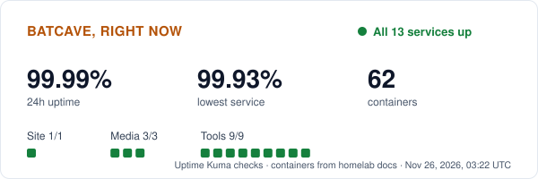
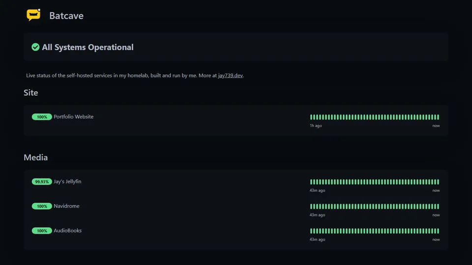
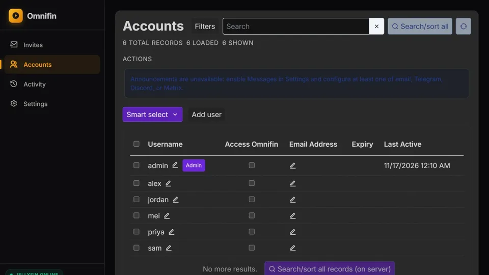
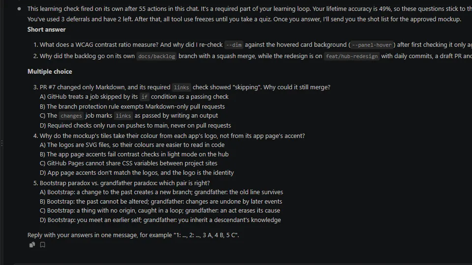
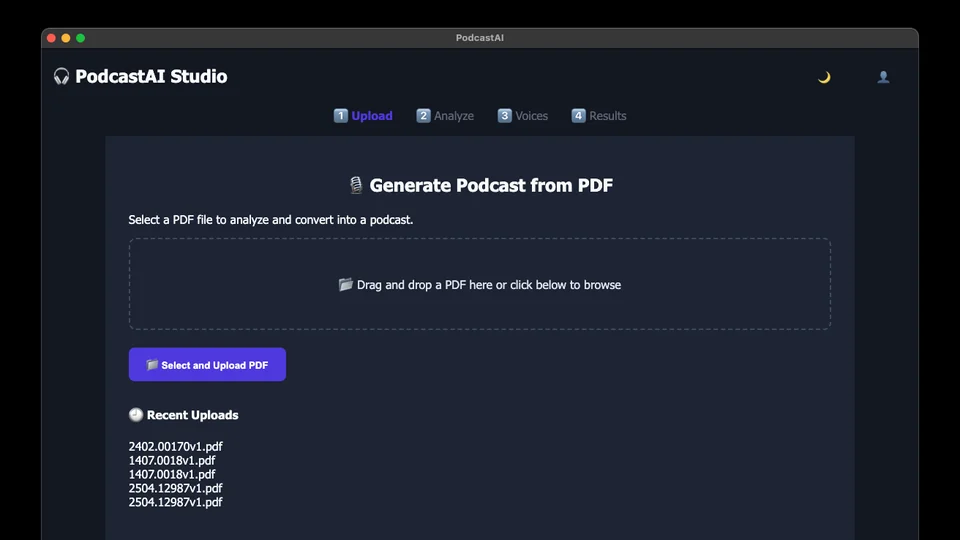
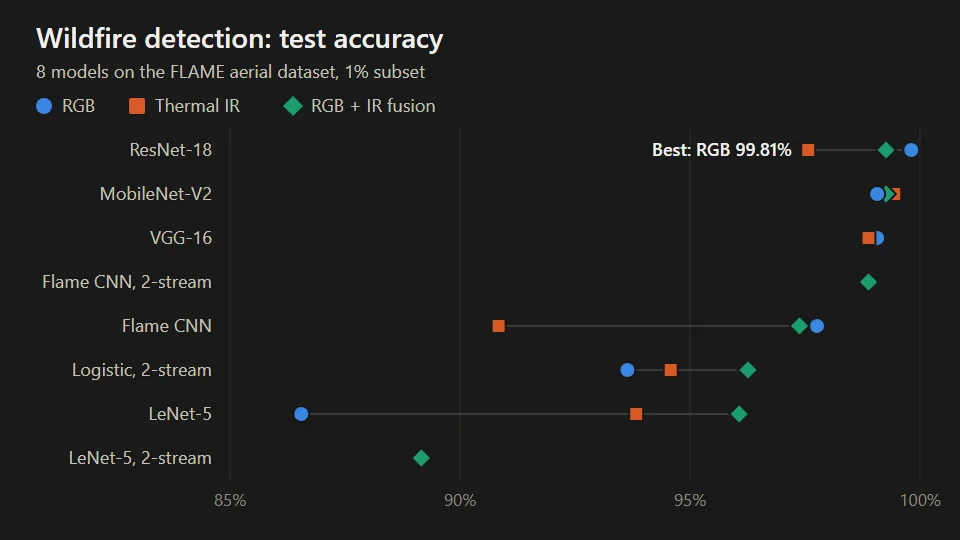
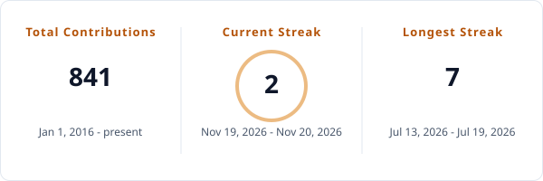

<div align="center">

<!-- ────────────────────────────────────────────────────────────── -->
<!--                            HEADER                              -->
<!-- ────────────────────────────────────────────────────────────── -->

<a href="https://jay739.dev">
  <picture>
    <source media="(prefers-color-scheme: dark)"
            srcset="https://capsule-render.vercel.app/api?type=waving&color=0:F59E0B%2C100:fde68a&height=170&section=header&text=Jayakrishna%20Konda&fontColor=f8fafc&fontSize=44&fontAlignY=38&desc=ML%2FAI%20Engineer%20%C2%B7%20Data%20Scientist%20%C2%B7%20Self-Hosted%20AI%20Builder&descSize=16&descAlignY=62&animation=fadeIn" />
    
  </picture>
</a>

<br/>

**Building production RAG pipelines, LLM systems, and self-hosted AI infrastructure, from model to deployment.**

<sub>Quick nav: <a href="#about">About</a> · <a href="#batcave">Batcave</a> · <a href="#featured-projects">Projects</a> · <a href="#latest-releases">Releases</a> · <a href="#github-highlights">Highlights</a> · <a href="#latest-from-the-blog">Blog</a></sub>

<br/>

<a href="https://jay739.dev"></a>
<a href="https://www.linkedin.com/in/jaya-krishna-konda/"></a>
<a href="mailto:contact@jay739.dev"></a>
<a href="https://jay739.dev/blog"></a>
<a href="https://apps.jay739.dev"></a>
<a href="https://github.com/jay739"></a>

<br/>

<!-- Live Batcave status, served by jay739.dev/api/badges/batcave -->

<a href="https://status.jay739.dev/status/batcave"></a>

</div>

<br/>

<a id="about"></a>

## <a href="#about"></a> About

I'm an ML/AI Engineer & Data Scientist, and this GitHub is where my projects live: RAG pipelines, LLM systems, and self-hosted AI infrastructure. I build them end to end, from model training to deployment and real-time monitoring.

The biggest one is **Batcave**, my solo-built private cloud: a Beelink mini-PC running <!--hl:batcave_containers-->62<!--/hl--> containers, linked over Tailscale to an Oracle Cloud edge server and an always-on Mac Mini M4 that serves the local LLMs ([live status](https://status.jay739.dev/status/batcave)).

```yaml
education: M.S. Data Science, UMBC (GPA 3.91 / 4.0)
focus: LLMs · RAG · MLOps · Self-hosted infrastructure
homelab: Batcave, self-hosted and drift-checked (live numbers below)
based_in: Maryland, USA
```

<br/>

<a id="open-to"></a>

## <a href="#open-to"></a> Open to

- Full-time ML/AI or MLOps engineering roles.
- Contract and advisory work for production RAG/LLM systems.
- Collaborations around self-hosted AI, homelab observability, and applied GenAI.

<br/>

<a id="batcave"></a>

## <a href="#batcave"></a> Batcave: My Private AI Cloud

> A solo-managed homelab on a Beelink mini-PC. Self-hosted from scratch. Live at [**jay739.dev**](https://jay739.dev).

<div align="center">

<!-- Values between hl markers are rewritten by .github/workflows/homelab-stats.yml. prettier-ignore keeps the formatter from padding every row to marker width. -->
<!-- prettier-ignore -->
| Metric | Value | Metric | Value |
| :-: | :-: | :-: | :-: |
| Containers on Batcave | <!--hl:batcave_containers-->`62`<!--/hl--> | Containers across the homelab | <!--hl:homelab_containers-->`86`<!--/hl--> |
| Compose services | <!--hl:services_declared-->`62`<!--/hl--> in <!--hl:compose_files-->`8`<!--/hl--> stacks | HTTPS sites | <!--hl:https_sites-->`38`<!--/hl--> |
| Health-checked | <!--hl:services_healthchecked-->`54`<!--/hl--> of <!--hl:services_declared-->`62`<!--/hl--> | Memory-capped | <!--hl:services_mem_limited-->`62`<!--/hl--> of <!--hl:services_declared-->`62`<!--/hl--> |
| Machines on the mesh | <!--hl:hosts-->`4`<!--/hl--> | LLM inference | `Mac Mini M4` |
| Drift: undeclared / missing | <!--hl:undeclared_containers-->`0`<!--/hl--> / <!--hl:missing_containers-->`0`<!--/hl--> | Docker networks | <!--hl:docker_networks-->`5`<!--/hl--> |

Services per stack: <!--hl:stacks-->media 25 · infra 14 · extras 12 · core 4 · immich 4 · cadence 1 · slskd 1 · ytdlp-shim 1<!--/hl-->

<sub>Counts are generated from my homelab's own docs, which an hourly drift check rebuilds from the live Docker daemon and proxy config. Last architecture change: <!--hl:docs_updated-->Nov 25, 2026<!--/hl-->.</sub>

<!-- Generated by .github/workflows/batcave-card.yml from the public status page, every 6 hours -->
<a href="https://status.jay739.dev/status/batcave">
  <picture>
    <source media="(prefers-color-scheme: dark)" srcset="https://raw.githubusercontent.com/jay739/jay739/main/profile/batcave-card.svg" />
    
  </picture>
</a>

</div>

**The machines**

| Host     | Hardware                        | Job                                       |
| -------- | ------------------------------- | ----------------------------------------- |
| Batcave  | Beelink SER8 mini PC            | Runs the Docker stack                     |
| Edge     | Oracle Cloud A1, 4 OCPU / 24 GB | Public edge, DNS and the off-site backups |
| Mac Mini | Apple M4                        | Always-on LLM inference                   |
| RTX box  | RTX 3060 Ti desktop             | CUDA work, woken on demand                |

**Backups, in three tiers:** a nightly copy to a second disk, a nightly encrypted copy off-site to the Oracle edge server, and a weekly independent copy to Google Drive.

Stack: `Docker` · `Ollama` · `Authentik SSO` · `Tailscale` · `Netdata` · `Nginx` · `PostgreSQL` · `MariaDB` · `Redis` · `Meilisearch`

Proof links: [Live Batcave status](https://status.jay739.dev/status/batcave) · [Batcave architecture series](https://jay739.dev/blog/docker-series-part5) · [OCI migration notes](https://jay739.dev/blog/migrating-do-to-oci)

→ Read the full [5-part Batcave blog series](https://jay739.dev/blog)

<br/>

<a id="tech-stack"></a>

## <a href="#tech-stack"></a> Tech Stack

<div align="center">

**Core:** `Python` · `PyTorch` · `Ollama` · `Docker` · `PostgreSQL` · `Redis` · `Next.js` · `TypeScript`

**Apps:** `Swift` · `Kotlin` · `Dart` · `Flutter` · `C#` · `Go`

<details>
<summary><b>Full badge stack</b></summary>
<br/>

**ML / AI**

[](https://www.python.org)
[](https://pytorch.org)
[](https://scikit-learn.org)
[](https://ollama.com)
[](https://huggingface.co)
[](https://spark.apache.org)

**MLOps · Infra · Cloud**

[](https://www.docker.com)
[](https://www.oracle.com/cloud/)
[](https://github.com/features/actions)
[](https://tailscale.com)
[](https://nginx.org)

**Data**

[](https://www.postgresql.org)
[](https://mariadb.org)
[](https://redis.io)
[](https://pandas.pydata.org)
[](https://numpy.org)
[](https://plotly.com)

**Frontend & Edge**

[](https://nextjs.org)
[](https://www.typescriptlang.org)
[](https://tailwindcss.com)
[](https://www.espressif.com)
[](https://isocpp.org)

**Native Apps & Services**

[](https://www.swift.org)
[](https://kotlinlang.org)
[](https://dart.dev)
[](https://flutter.dev)
[](https://dotnet.microsoft.com)
[](https://go.dev)

</details>

</div>

<br/>

<a id="featured-projects"></a>

## <a href="#featured-projects"></a> Featured Projects

<table>
<tr>
<td width="50%" valign="top">

#### <a href="https://jay739.dev"></a>&nbsp; [Batcave: Personal AI Cloud](https://jay739.dev)

<a href="https://status.jay739.dev/status/batcave"></a>

My self-hosted private cloud: a Beelink mini-PC running <!--hl:batcave_containers-->62<!--/hl--> containers and <!--hl:https_sites-->38<!--/hl--> HTTPS sites behind Authentik SSO. Netdata alerts go to Telegram, and a Mac Mini M4 serves the local LLMs through Ollama.

`Docker` · `Ollama` · `Authentik` · `Tailscale`

**[Live status](https://status.jay739.dev/status/batcave)** · [Architecture series](https://jay739.dev/blog/docker-series-part5)

</td>
<td width="50%" valign="top">

#### <a href="https://github.com/jay739/openhaze"></a>&nbsp; [OpenHaze](https://github.com/jay739/openhaze)

<a href="https://apps.jay739.dev/openhaze/"></a>

A native window dimmer for macOS and Windows: everything but the window in focus fades into an adjustable haze. About 2,100 lines per platform in Swift and C#, with no dependencies.

`Swift` · `C#` · `AppKit` · `WinForms`

**[Download](https://apps.jay739.dev/openhaze/)** · [Source](https://github.com/jay739/openhaze)

</td>
</tr>
<tr>
<td width="50%" valign="top">

#### <a href="https://github.com/jay739/omnifin"></a>&nbsp; [Omnifin](https://github.com/jay739/omnifin)

<a href="https://apps.jay739.dev/omnifin/"></a>

Jellyfin user management in one self-hosted binary: invites, account lifecycle, password resets and notifications. A credited hard fork of [hrfee/jfa-go](https://github.com/hrfee/jfa-go) that adds library-driven announcement emails and a Tauri desktop client.

`Go` · `Jellyfin` · `Tauri` · `Docker`

**[Download](https://apps.jay739.dev/omnifin/)** · [Source](https://github.com/jay739/omnifin)

</td>
<td width="50%" valign="top">

#### <a href="https://github.com/jay739/claude-pop-quiz"></a>&nbsp; [claude-pop-quiz](https://github.com/jay739/claude-pop-quiz)

<a href="https://apps.jay739.dev/claude-pop-quiz/"></a>

A Claude Code hook that pauses every 40 to 45 actions and quizzes you on your own session. Graded answers feed a learning journal that drives spaced repetition and adaptive difficulty.

`Python` · `Claude Code` · `Hooks` · `Spaced repetition`

**[Install](https://apps.jay739.dev/claude-pop-quiz/)** · [Source](https://github.com/jay739/claude-pop-quiz)

</td>
</tr>
<tr>
<td width="50%" valign="top">

#### <a href="https://github.com/jay739/PodcastAI"></a>&nbsp; [RAG Podcast Generator](https://github.com/jay739/PodcastAI)

<a href="https://jay739.dev/ai-tools"></a>

Turns a PDF book into a character-voiced podcast. PyMuPDF extracts the text, FAISS retrieves passages, Llama 3.1 8B writes the script through Ollama, and Bark voices each speaker.

`RAG` · `FAISS` · `Ollama` · `Bark TTS`

**[Try it](https://jay739.dev/ai-tools)** · [Write-up](https://jay739.dev/blog/ai-pdf-to-podcast)

</td>
<td width="50%" valign="top">

#### <a href="https://github.com/jay739/forest-fire-detection"></a>&nbsp; [Wildfire Detection](https://github.com/jay739/forest-fire-detection)

<a href="https://nbviewer.org/urls/raw.githubusercontent.com/jay739/forest-fire-detection/main/eval.ipynb"></a>

Benchmarked 8 models on the FLAME aerial dataset in RGB, thermal IR and RGB+IR fusion. Best was ResNet-18 on RGB at 99.8% test accuracy, on a 1% subset of about 107 test images.

`PyTorch` · `CNN` · `Computer Vision` · `Thermal IR`

**[Notebook](https://nbviewer.org/urls/raw.githubusercontent.com/jay739/forest-fire-detection/main/eval.ipynb)** · [Source](https://github.com/jay739/forest-fire-detection)

</td>
</tr>
</table>

→ See [more projects on jay739.dev](https://jay739.dev/projects)

<br/>

<a id="latest-releases"></a>

## <a href="#latest-releases"></a> Latest Releases

<!-- Generated by .github/workflows/releases.yml from each public repo's latest GitHub release -->
<!-- RELEASES:START -->
- [**openhaze** v0.4.0](https://github.com/jay739/openhaze/releases/tag/v0.4.0) · Native, dependency-free window-dimming utility for macOS and Windows, inspired by HazeOver · **123 downloads** <sub><i>Nov 21, 2026</i></sub>
- [**claude-pop-quiz** v0.5.3](https://github.com/jay739/claude-pop-quiz/releases/tag/v0.5.3) · Mandatory, automatic pop-quiz hook for Claude Code. It quizzes you on your own sessions every 40 to 45 actions to counter agentic context loss. <sub><i>Oct 27, 2026</i></sub>
- [**sitrep** v0.1.0](https://github.com/jay739/sitrep/releases/tag/v0.1.0) · Self-hosted status page over Uptime Kuma: incidents, RSS, Telegram notifications <sub><i>Sep 30, 2026</i></sub>
- [**cadence** v0.1.0](https://github.com/jay739/cadence/releases/tag/v0.1.0) · Per-song music request service: search, request, and auto-fulfil single tracks into a self-hosted library <sub><i>Sep 25, 2026</i></sub>
- [**omnifin** v1.4.1](https://github.com/jay739/omnifin/releases/tag/v1.4.1) · Jellyfin user management, a redesigned hard fork of hrfee/jfa-go · **507 downloads** <sub><i>Sep 25, 2026</i></sub>
- [**sitediff** v0.1.0](https://github.com/jay739/sitediff/releases/tag/v0.1.0) · Compare the visible content of two renderings of the same page, across environments. <sub><i>Aug 19, 2026</i></sub>
<!-- RELEASES:END -->

→ All apps, with downloads, at [apps.jay739.dev](https://apps.jay739.dev)

<br/>

<a id="github-highlights"></a>

## <a href="#github-highlights"></a> GitHub Activity

<div align="center">

<!-- Generated by .github/workflows/metrics.yml, committed to the `main` branch. Transparent with neutral text, so one file serves both themes -->
<a href="https://github.com/jay739?tab=repositories"></a>

<br/><br/>

<!-- Generated by .github/workflows/streak.yml, committed to the `main` branch -->
<a href="https://github.com/jay739">
<picture>
  <source media="(prefers-color-scheme: dark)" srcset="https://raw.githubusercontent.com/jay739/jay739/main/profile/streak-stats.svg" />
  
</picture>
</a>

</div>

<div align="center">

<details>
<summary><b>More: coding habits & topics</b></summary>
<br/>
<a href="https://github.com/jay739?tab=repositories"></a>
<br/><br/>
<a href="https://github.com/jay739?tab=repositories"></a>
<br/><br/>
<a href="https://github.com/jay739?tab=repositories"></a>
<br/><br/>
<a href="https://github.com/jay739?tab=repositories"></a>
<br/><br/>
<a href="https://github.com/jay739?tab=repositories"></a>
</details>

</div>

<br/>

<a id="contribution-snake"></a>

## <a href="#contribution-snake"></a> Contribution Snake

<div align="center">

<!-- Generated by .github/workflows/snake.yml, pushed to the `output` branch -->
<a href="https://github.com/jay739/snk">
<picture>
  <source media="(prefers-color-scheme: dark)"
          srcset="https://raw.githubusercontent.com/jay739/jay739/output/github-contribution-grid-snake-dark.svg" />
  <source media="(prefers-color-scheme: light)"
          srcset="https://raw.githubusercontent.com/jay739/jay739/output/github-contribution-grid-snake-light.svg" />
  
</picture>
</a>

<sub>Rendered by <a href="https://github.com/jay739/snk">my fork of Platane/snk</a>, which I extended so the snake grows as it eats.</sub>

</div>

<br/>

<a id="latest-from-the-blog"></a>

## <a href="#latest-from-the-blog"></a> Latest from the Blog

<!-- BLOG-POST-LIST:START --><br>&bull; <a href="https://jay739.dev/blog/ollama-mlx-benchmarking-rtx-vs-mac-mini">Benchmarking Local LLMs Across an RTX 3060 Ti and an M4 Mac Mini &lpar;With a Kernel Panic Along the Way&rpar;</a> <sub><i>Jul 16, 2026</i></sub><br>&bull; <a href="https://jay739.dev/blog/batcave-usb-nic-root-cause">The Freeze Wasn&#39;t Memory: Tracing a Homelab Server&#39;s Root Cause Through Three Wrong Turns</a> <sub><i>Jul 16, 2026</i></sub><br>&bull; <a href="https://jay739.dev/blog/ai-quizzes-me-claude-code-hooks">I Made My AI Ambush Me With Pop Quizzes</a> <sub><i>May 29, 2026</i></sub><br>&bull; <a href="https://jay739.dev/blog/lifetime-software-deals">The Quiet Math of Lifetime Software Deals</a> <sub><i>May 12, 2026</i></sub><br>&bull; <a href="https://jay739.dev/blog/homelab-lessons">What Running a Homelab Actually Teaches You That Work Doesn&#39;t</a> <sub><i>Apr 24, 2026</i></sub><!-- BLOG-POST-LIST:END -->

→ More at [**jay739.dev/blog**](https://jay739.dev/blog) · auto-refreshed every 6 hours from `jay739.dev/rss.xml`

<br/>

<div align="center">

### Let's build something.

<a href="https://jay739.dev"></a>
<a href="mailto:contact@jay739.dev"></a>
<a href="https://www.linkedin.com/in/jaya-krishna-konda/"></a>

<sub><i>"From model to deployment, and the homelab in between."</i></sub>

<a href="https://jay739.dev">
<picture>
  <source media="(prefers-color-scheme: dark)" srcset="https://capsule-render.vercel.app/api?type=waving&color=0:fde68a%2C100:F59E0B&height=80&section=footer&reversal=true" />
  
</picture>
</a>

</div>
